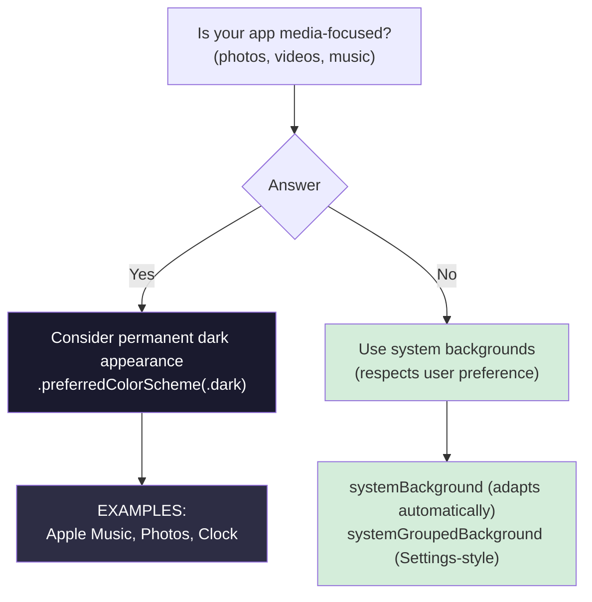
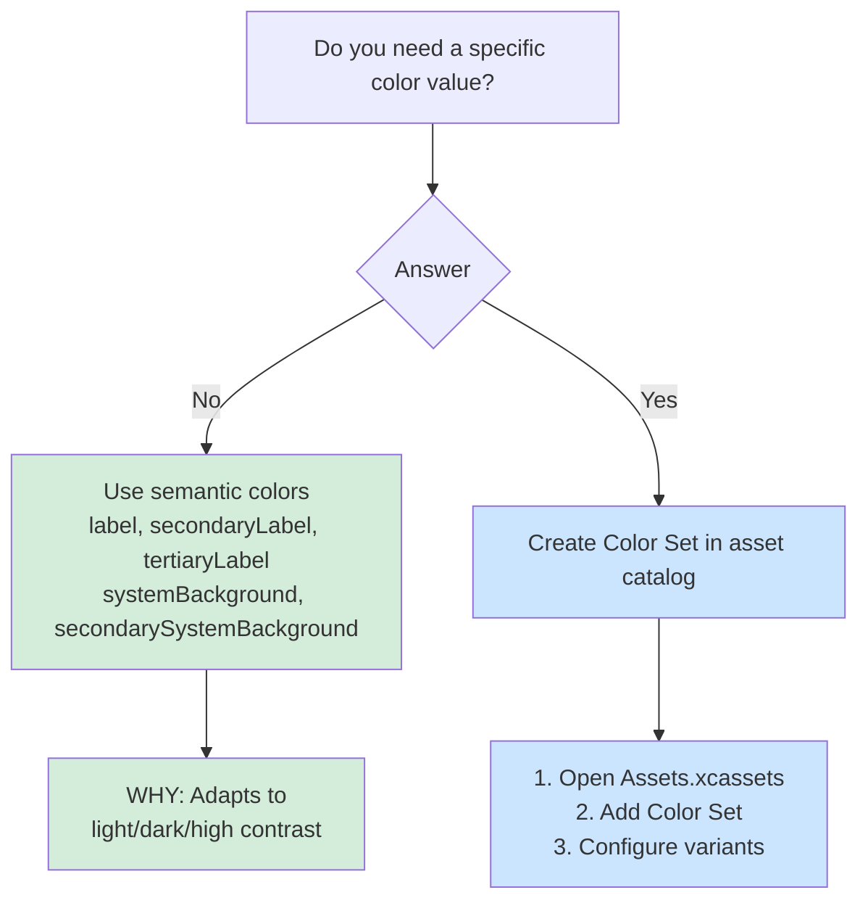

# Human Interface Guidelines

Quick decision frameworks and checklists for Apple's Human Interface Guidelines (HIG), Apple's design rules for its platforms. Covers backgrounds, color, typography, touch targets, spacing, and how to defend a design decision when a stakeholder pushes back.

## When to Use

Use this skill when you're:
- Making visual design decisions (colors, backgrounds, typography)
- Reviewing UI for HIG compliance
- Asking "Should I use a dark background?"
- Choosing between design options
- Defending design decisions to stakeholders
- Looking up the answer to a common design question

## Example Prompts

Questions you can ask your assistant that will draw from this skill:

- "Should I use a dark background for my media app?"
- "What semantic colors should I use for labels?"
- "Which font weights are recommended for body text?"
- "How do I create colors that adapt to light and dark mode?"
- "What contrast ratio does my text need?"
- "Is my touch target too small?"
- "What spacing should I use between these views?"
- "Should this list have an A–Z index strip down the side?"
- "Why does my section index overlap the row chevrons?"
- "Should deleting a file show a confirmation alert?"
- "Our designer wants an Ultralight font and a custom dark mode toggle. How do I push back?"

## What This Skill Provides

### Backgrounds and Color
- When a permanent dark appearance fits (media-focused apps), and when to respect the user's choice
- System backgrounds (`systemBackground`, `systemGroupedBackground`) and semantic label colors (`label`, `secondaryLabel`)
- Color Sets for custom colors, with light, dark, and high-contrast variants
- Contrast ratios (4.5:1 minimum, 7:1 recommended for small text)
- Why apps shouldn't offer their own appearance setting

### Typography and Icons
- Font weights to avoid (Ultralight, Thin, Light) and to prefer (Regular, Medium, Semibold, Bold)
- Dynamic Type support
- When to use SF Symbols and when a custom icon is justified

### Touch Targets
- Minimum sizes per platform (44×44 points on iOS and iPadOS, 20×20 on macOS)
- Spacing between targets

### Spacing, Padding, and Margins
- Why Apple publishes no iOS spacing scale, and what to do instead
- Which modifiers supply the system value when you omit the length, and which need an explicit `nil`
- The three cases where a hardcoded value is legitimate
- UIKit equivalents: the layout margins guide, directional layout margins, and the readable content guide

### Section Index
- When an A–Z index strip earns its place on a list
- The hard rule against pairing an index with trailing row controls
- Platform differences: watchOS shows the index only during crown scrolling, and macOS and tvOS have none

### Alerts
- When an alert is warranted, and when an action sheet, inline indicator, or Undo fits better
- Why a confirming button isn't always destructive-styled, and why action sheets reverse that rule
- The SwiftUI difference to remember: `.alert` adds no Cancel button, while `.confirmationDialog` does

### Reviews and Pushback
- A pre-ship checklist for appearance, typography, accessibility, motion, and localization
- A design review checklist
- A four-step way to push back on requests that violate the HIG, and when to accept the decision
- The three core HIG principles (clarity, consistency, deference) and quick tips for each platform

## Key Patterns

### Background Color Decision Tree



### Color Selection Decision Tree



### Font Weight Decision

```swift
// ❌ AVOID — Legibility issues
.font(.system(.body, weight: .ultraLight))
.font(.system(.body, weight: .thin))
.font(.system(.body, weight: .light))

// ✅ PREFER — Good legibility
.font(.system(.body, weight: .regular))
.font(.system(.body, weight: .medium))
.font(.headline)  // Semibold by default
```

## Documentation Scope

This page documents the `hig` skill (in the `axiom-design` suite), which your assistant draws on when you make design decisions or review UI for HIG compliance.

- For payment design rules, see [apple-pay](/skills/integration/apple-pay) (the Apple Pay button and mark), [wallet-passes](/skills/integration/wallet-passes), and [tap-to-pay](/skills/integration/tap-to-pay)

## Related

- [hig-ref](/reference/hig-ref) – The comprehensive HIG reference, with code examples
- [liquid-glass](/skills/ui-design/liquid-glass) – The iOS 26 Liquid Glass material, and supporting both the old and new designs in one app
- [typography-ref](/reference/typography-ref) – Text styles, Dynamic Type, and font details beyond the weight rules here
- [sf-symbols](/skills/ui-design/sf-symbols) – Rendering modes and effects once you've chosen SF Symbols over custom icons
- [accessibility-diag](/diagnostic/accessibility-diag) – Fixing the contrast, touch-target, and VoiceOver problems the checklists catch
- [swiftui-layout](/skills/ui-design/swiftui-layout) – Adaptive layout patterns that build on the spacing rules

## Resources

**WWDC**: 2019-808, 2025-356

**Docs**: /design/human-interface-guidelines, /design/human-interface-guidelines/layout, /design/human-interface-guidelines/color, /design/human-interface-guidelines/dark-mode, /design/human-interface-guidelines/typography, /design/human-interface-guidelines/lists-and-tables
