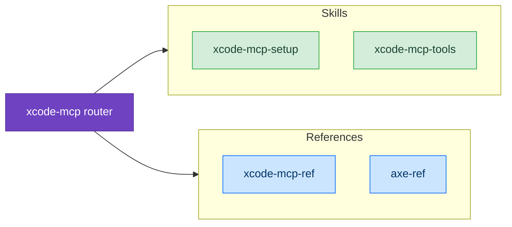

# Xcode MCP Integration

Xcode ships a built-in MCP (Model Context Protocol) server that exposes IDE tools to external AI clients, and on Xcode 27 it can also run headless, with Xcode closed. This skill suite teaches your assistant how to set up, connect, and use those tools, from building and testing to rendering SwiftUI previews.

## When to Use These Skills

Use these skills when:
- Setting up `xcrun mcpbridge` for the first time
- Running MCP headless, in CI or without keeping Xcode open
- Building, testing, or previewing your project via MCP tools
- Troubleshooting connection, permission, or hung-call problems
- Learning Xcode MCP workflow patterns (workspace bootstrap, BuildFix loop, TestFix loop)
- Looking up specific tool parameters and schemas
- Driving simulator input with AXe (`tap`, `type`, `swipe`)

## Example Prompts

Questions you can ask your assistant that will draw from these skills:

- "How do I set up Xcode MCP with Claude Code?"
- "Build my project using MCP tools"
- "How do I run Xcode MCP without keeping Xcode open?"
- "My mcpbridge connection keeps failing"
- "What parameters does BuildProject take?"
- "Run just the failing test, not the whole suite"
- "Render the preview for my ContentView"
- "My MCP tool call just hangs and never returns"
- "How do I render an interactive preview, or choose a preview destination, on Xcode 27.2?"

## What These Skills Provide

- **Setup guides** – Five MCP clients (Claude Code, Cursor, Codex, VS Code, Gemini CLI), in attached or headless mode
- **Workflow patterns** – Workspace bootstrap, iterative BuildFix and TestFix loops, preview verification
- **Tool references** – The 54-tool Xcode 27.2 schemas, the fields that differ on 27.2 beta 2 and earlier builds, return shapes, and gotchas
- **Workspace targeting** – Identifier management, and why an identifier is required even with one project open
- **Troubleshooting** – Hung calls, agent approval, empty tool lists, stale connections
- **Conflict resolution** – When to use MCP tools, `xcodebuild`, or your assistant's standard file tools
- **Simulator input** – AXe, a command-line tool that reads the simulator's accessibility tree and drives it with `tap`, `type`, and `swipe`

## Skill Suite

The `axiom-xcode-mcp` router reads your question and loads one of four specialized skills:

| Skill | Type | Purpose |
|-------|------|---------|
| `axiom-xcode-mcp` | Router | Routes to the right specialized skill |
| [`xcode-mcp-setup`](/skills/xcode-mcp/xcode-mcp-setup) | Discipline | Enable, connect, and troubleshoot per client |
| [`xcode-mcp-tools`](/skills/xcode-mcp/xcode-mcp-tools) | Discipline | Workflow patterns, gotchas, workspace targeting |
| [`xcode-mcp-ref`](/reference/xcode-mcp-ref) | Reference | Xcode 27.2 tool schemas and the fields that differ on other builds |
| [`axe-ref`](/reference/axe-ref) | Reference | AXe simulator input (`tap`/`type`/`swipe`) |

## The Xcode MCP Tools

Xcode 27.2 (27B52, and its RC) and Xcode 27.0 list all 54 tools with no workspace open, including `DocumentationSearch`, and the 27.1 RC lists the same 54. Xcode 27.2 beta 2 (27B5028f) lists 53, without `DocumentationSearch`, whether or not the agent is approved and a workspace is open. On 27.2 builds `RenderPreview` can choose a render destination, and from the 27.2 RC it also renders interactive previews and returns its results under new field names. The `GetCodeCoverage` tool announced in the 27.2 beta 2 and RC release notes isn't in the released 27.2. Check the live tool list before calling a tool, because a shorter list alone doesn't mean a workspace or approval problem. The full per-tool reference is in [Xcode MCP Reference](/reference/xcode-mcp-ref).

| Category | Tools |
|----------|-------|
| Workspaces & Projects | `XcodeListWorkspaces`, `XcodeOpenWorkspace`, `XcodeCloseWorkspace`, `XcodeNewProject`, `XcodeListTemplates`, `XcodeNewTarget`, `XcodeListTargets` |
| File Read | `XcodeRead`, `XcodeGlob`, `XcodeGrep`, `XcodeLS` |
| File Write | `XcodeWrite`, `XcodeUpdate`, `XcodeMakeDir` |
| File Destructive | `XcodeRM`, `XcodeMV` |
| Build | `BuildProject`, `GetBuildLog`, `XcodeRefreshCodeIssuesInFile`, and build-setting and compiler-flag tools |
| Run & Debug | `RunProject`, `StopProject`, `GetConsoleOutput`, `InvokeDebuggerCommand`, `RunCodeSnippet` |
| Test | `RunAllTests`, `RunSomeTests`, `GetTestList`, test-plan tools |
| Schemes & Destinations | `XcodeListSchemes`, `XcodeSwitchScheme`, `XcodeListRunDestinations`, `XcodeSwitchRunDestination` |
| Preview | `RenderPreview` |
| Device Interaction | `DeviceInteractionStartSession`, `DeviceInteractionSynthesize`, and session tools |
| Crash & Field Diagnostics | `GetTopCrashIssues`, `GetCrashIssueLogs`, and field-performance tools |
| Localization | `LocalizationPlanner`, `StringCatalogRead`, `StringCatalogEdit`, `StringCatalogContext` |
| Project Configuration | `AddEntitlement`, `AddInfoPlist` |
| Documentation | `DocumentationSearch` (absent on 27.2 beta 2) |

## Requirements

- **Xcode 26.3+** with MCP enabled in Settings > Intelligence and a project open (attached mode)
- **Xcode 27** additionally supports headless operation with Xcode closed, after a one-time `sudo xcrun mcp-server enable`
- **macOS** with Xcode installed

## Related

- [Xcode Debugging](/skills/debugging/xcode-debugging) – Environment-first diagnostics (Derived Data, zombie `xcodebuild` processes) — use it when the problem is the Xcode environment, not MCP
- [Apple Documentation Access](/skills/integration/apple-docs) – Reads the for-LLM guides bundled inside Xcode — use it for those guides, and as the fallback when `DocumentationSearch` is missing
- [Build Debugging](/skills/debugging/build-debugging) – Dependency and build-configuration failures (CocoaPods, SPM, framework conflicts) — use it when a build fails for reasons MCP tools can't fix
- [Device Control](/reference/device-control-ref) – Drive simulators and devices from the command line with `devicectl`, `simctl`, and Axiom's tools, without keeping Xcode open
